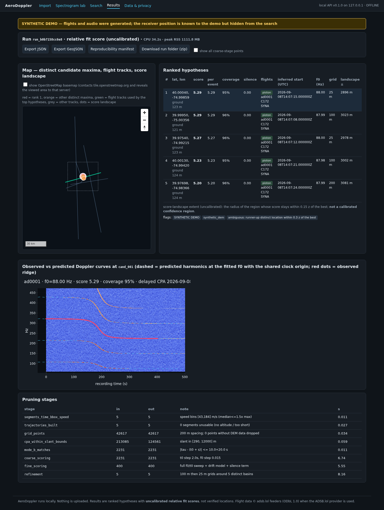
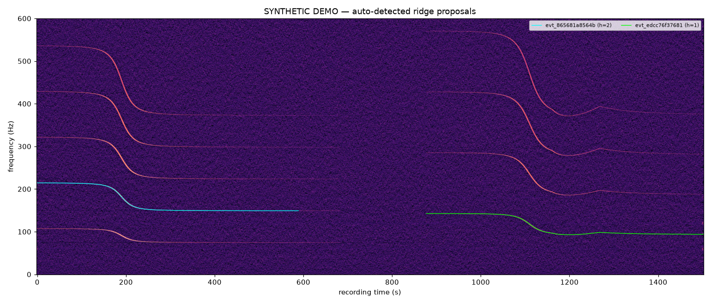
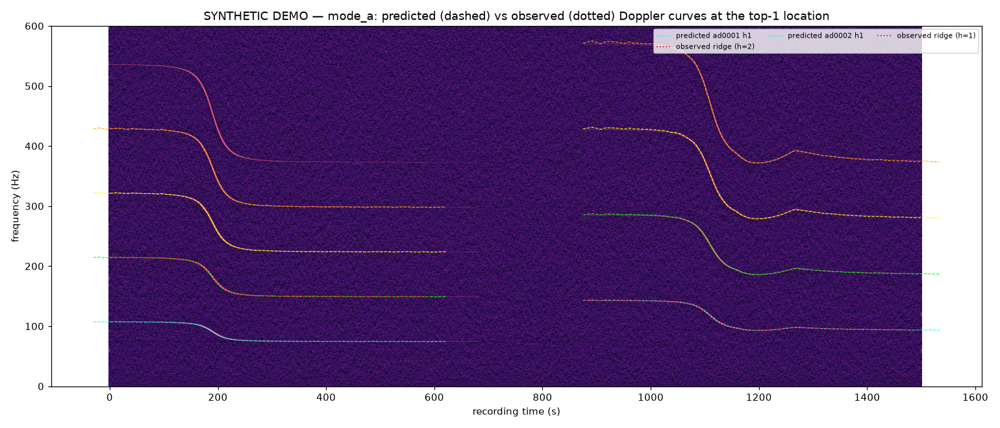
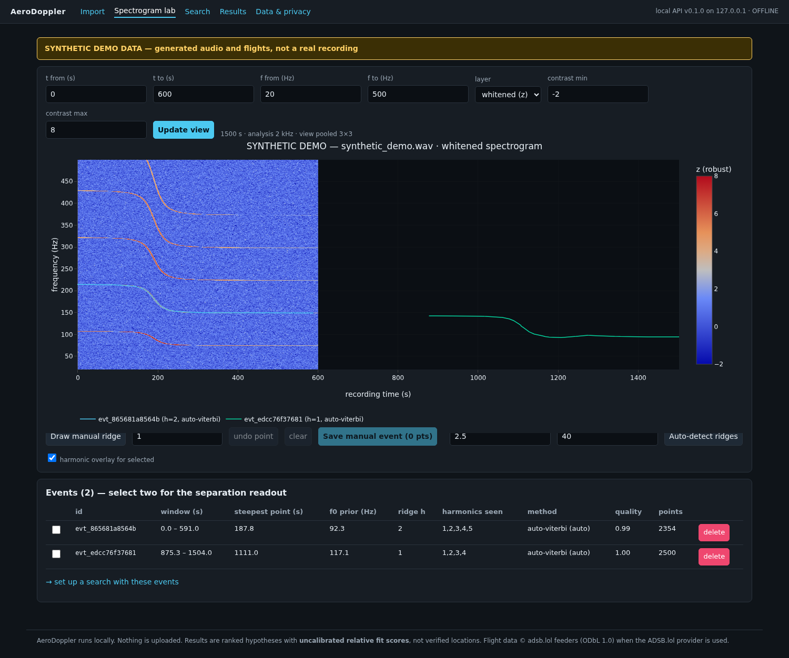
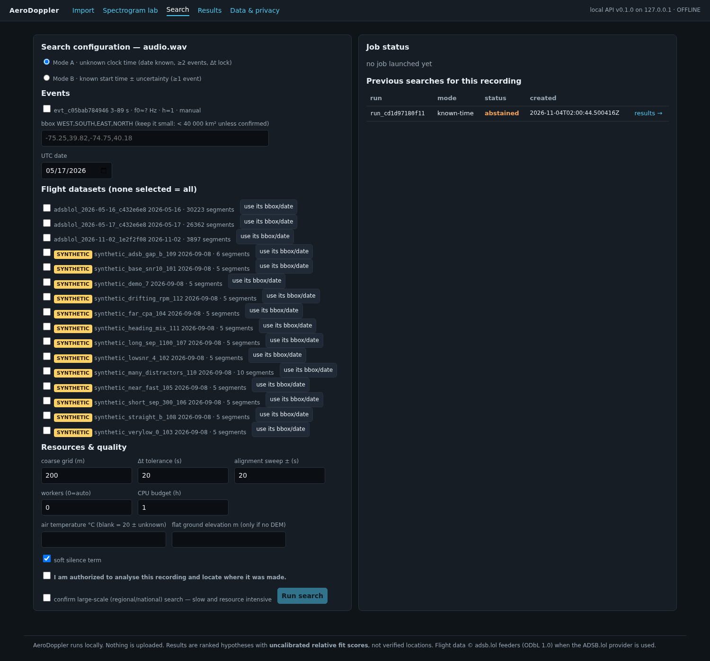

# AeroDoppler

Local-first research tool that estimates where a **stationary recording you own** was made,
by matching weak propeller-aircraft Doppler ridges in its spectrogram against historical ADS-B
trajectories (ADSB.lol archive) with an emission-time-correct acoustic forward model.

> **Consent and scope.** AeroDoppler is for recordings you own or have explicit permission to
> analyse. Every ingest and search requires an authorization acknowledgement. The server binds to
> localhost, nothing is uploaded, and every result is a *ranked hypothesis with an uncalibrated
> relative fit score* — never an address or a probability. See `docs/privacy.md`.

Status: all milestones M0–M7 of `SPEC.md` are implemented and tested; M7 includes synthetic,
semi-synthetic (real ADS-B tracks) and a **real-recording benchmark on 29 published CC-BY phone
recordings** (single pass, known time) with honest, unflattering numbers. Details, observed
outputs and the remaining-issues list are in `IMPLEMENTATION_REPORT.md`.



## Quick start (clean machine)

Requirements: Python ≥ 3.12 via [uv](https://docs.astral.sh/uv/), FFmpeg (`apt install ffmpeg`;
a bundled fallback via `imageio-ffmpeg` is used if absent), Node 22+ for the UI (optional).

```bash
make setup              # uv sync --all-extras
make test-fast          # unit + fixture tests (~1 min, offline)
make demo               # fully offline SYNTHETIC end-to-end: ~3 min on 8 cores
make web-install && make web-build   # optional UI (Next.js static export)
make serve              # http://127.0.0.1:8000  (API docs at /docs)
```

`make demo` generates two synthetic propeller flights plus distractors, a synthetic DEM, a 25-min
recording synthesised with an independent retarded-time simulator, ingests it, auto-detects the
Doppler events, runs an unknown-time (Mode A) and a known-time (Mode B) search and writes plots
to `data/runs/demo/`:

| | |
|---|---|
|  |  |
| auto-detected ridges (SYNTHETIC) | observed (dotted) vs predicted (dashed) curves at the top-1 location |

Observed demo result (seed 7, SNR 10 dB at CPA, final code): Mode A top-1 error **7.3 m** with
the recording clock recovered to 0.2 s; Mode B (known time ±10 s, one straight flyby, which is
along-track/mirror ambiguous) **128 m**. These are synthetic numbers; see "Benchmarks" below.

Full test suite including the slow end-to-end and API tests (~10 min):

```bash
make test
```

Docker (port published on 127.0.0.1 only). Note: the image build could not be verified in the
development environment (the Docker daemon there cannot resolve registry hostnames); the
Dockerfile mirrors the tested local install steps.

```bash
docker compose up --build
```

## Workflow with real data

1. **Import flights** for the UTC date of the recording. ADSB.lol publishes one whole-sky
   archive per day (≈3.3–3.5 GB); it is downloaded once, cached under `data/raw/`, and filtered to
   your bounding box (+15 km margin). You must confirm the download size.

   ```bash
   uv run aerodoppler flights import --provider adsblol --date 2026-11-02 --bbox -81.8,28.6,-80.8,29.6 --confirm-download
   ```

2. **Ingest the recording** (WAV/FLAC/MP3/video). Give the UTC date (unknown-time mode) or the
   UTC start time with its uncertainty (known-time mode).

   ```bash
   uv run aerodoppler audio ingest ./my_recording.wav --date 2026-11-02 --authorized
   uv run aerodoppler audio spectrogram <recording-id> --png spec.png
   uv run aerodoppler audio detect <recording-id>          # editable proposals
   uv run aerodoppler audio add-event <recording-id> --points "120:95.2,150:93.0,190:84.1,230:80.3" --harmonic 1
   ```

3. **Search** (bounded bbox; large areas need `--confirm-large-scale`):

   ```bash
   uv run aerodoppler search --recording <id> --mode unknown-time --date 2026-11-02 --bbox -81.3,28.9,-81.0,29.2 --events <id1>,<id2> --authorized
   uv run aerodoppler search --recording <id> --mode known-time --start-utc 2026-11-02T15:04:00Z --start-uncertainty-s 10 --bbox -81.3,28.9,-81.0,29.2 --events <id1> --authorized
   uv run aerodoppler results export <run-id> --format geojson
   ```

4. **Review in the UI** (`make serve`): Import → Spectrogram lab (zoom, contrast, click-to-draw
   ridges, harmonic overlay, Δt readout) → Search (Mode A/B, resource caps, live progress, cancel)
   → Results (map with tracks, distinct maxima and score landscape; ranked table; observed vs
   predicted overlays; JSON/GeoJSON/manifest/zip export) → Data & privacy (purge, audit log).

| Spectrogram lab | Search |
|---|---|
|  |  |

Elevation: USGS 3DEP (CONUS) or Copernicus GLO-30 tiles are fetched and cached automatically for
the search bbox; drop your own GeoTIFF into `data/dem/`; or pass `--ground-elevation` explicitly
(flagged). `AERODOPPLER_OFFLINE=true` forbids every network access.

## How it works (short)

Emission-time Doppler model `f_r = f_s · c/(c − v_toward)` with `t_r = t_e + r/c` on real
piecewise-linear trajectories; delayed CPA timing; candidate ground grid (200 m) with DEM;
Mode A pairs flights whose delayed-CPA difference equals the observed event separation, Mode B
matches the known clock; curves are scored on a whitened spectrogram with harmonics, an RPM-drift
nuisance and **one shared clock origin** (event 2 is never slid independently); soft silence
term; 100 m → 25 m refinement; abstention when evidence is insufficient. `docs/theory.md` has the
details and the known degeneracies.

## Benchmarks (honest summary)

* **Synthetic benchmark** (12 scenarios, simulated audio and flights, limited geometric
  diversity): Mode A (unknown time) top-1 error median 33 m, p90 45 m, max 53 m, 12/12 correct
  flight pairs, no false matches; Mode B (known time ±10 s) median 7 m. Measures the inverse
  engine, not real-world accuracy (`IMPLEMENTATION_REPORT.md` §M7).
* **Semi-synthetic benchmark** on real ADSB.lol trajectories (central Florida, 2026-11-02,
  ~1,250 real segments as distractors, real USGS 3DEP terrain, simulated audio): see
  `IMPLEMENTATION_REPORT.md` §M7 for the per-case table including the failures.
* **Real recordings** (Pathak Livermore set, Zenodo 23424278, CC BY 4.0; 29 single-pass phone
  recordings on two days, recorder position trilaterated from the published track offsets,
  events detected blind, known-time ±2 s, 4 km offset box, full-day real traffic + 3DEP):
  16 answered / 13 abstained; answered top-1 median **391 m**, best-of-top-3 median 179 m,
  correct aircraft 88 %; over all 29 incl. abstained candidates top-1 median 482 m, 54 % within
  500 m, 39 % beyond 1 km (mostly the mirror solution of a single pass). Details and the per-case
  table in `IMPLEMENTATION_REPORT.md` §M7; raw JSON in `docs/livermore_benchmark_2026-11-03.json`.
  `aerodoppler benchmark --manifest cases.json` runs the same protocol on your own consented
  recordings. Every score remains labelled uncalibrated.

## Cost and storage caveats

* One ADSB.lol day ≈ 3.3–3.5 GB download (cached); a 1°×1° bbox normalises to ≈ 8 MB Parquet.
* DEM tiles: a 0.3°×0.3° 3DEP export ≈ 5 MB; Copernicus 1° tiles 1–45 MB each.
* A bounded search with few flights (synthetic demo: 0.5°×0.36° bbox, 5 segments) takes 1.5–2.5
  min on 6–8 cores and ~1 GB RSS. With real traffic (1,300 segments in a 36×33 km box, ~10⁷ CPA
  entries) the Mode A pair cap (`quality_settings.max_assignments`, default 200,000, selected by
  a physical consistency prior when exceeded) dominates: ~25 min on 6 cores and ~2.3 GB RSS at the
  default cap, ~8 min at 60,000. National-scale search is opt-in and not optimised.

## Data attribution and licences

Flight data © adsb.lol feeders, Open Database License (ODbL) 1.0
(https://www.adsb.lol/docs/open-data/historical). Elevation: USGS 3DEP (public domain),
Copernicus DEM GLO-30 (© DLR e.V. 2010-2014 and © Airbus Defence and Space GmbH 2014-2018, provided
under COPERNICUS by the European Union and ESA). Geoid: EGM96 (NGA, public domain). This software:
MIT. Case-study reference: Colsto, *I discovered a sound that leaks your exact location*
(https://www.youtube.com/watch?v=UytYrhYLOKI) — a demonstration, not a validated accuracy claim.
